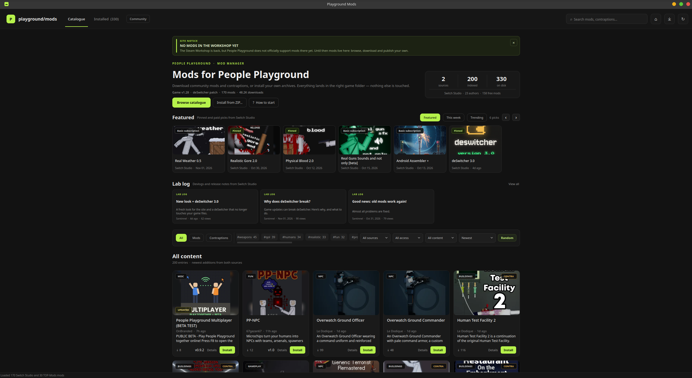

# Playground Mods



A native desktop application for browsing and installing People Playground content
from **Switch Studio**. Mods and contraptions are downloaded and extracted
straight into the correct game folder — no browser, no manual copying.

The app only ever writes inside the People Playground `Mods` and `Contraptions`
directories. It never touches game settings, save files, or anything else in the
game folder.

## Features

- Native Qt (PySide6) interface with a dark, focused catalogue: a fixed header,
  a centred content column, responsive card grids, and one shared search field
  that follows the active page. Not a web page.
- Live catalogue from Switch Studio, cached to disk so the app opens instantly
  and still works offline.
- **Automatic game-folder detection.** The app scans Steam libraries on Linux,
  Windows, and macOS, remembers the folder it finds, and lets you change it from
  the Community menu if needed.
- Home discovery built from the public site data: live mod/download/author
  stats, the current site notice, a Featured / This week / Trending rail with
  the site's pinned and paid picks, and a lab-log strip with the latest Switch
  Studio posts.
- Rich mod pages: full description with Markdown, cover gallery, spec sheet,
  version changelog, dependencies, related mods, and a read-only mirror of the
  public comments. Featured, pinned, updated, broken, tier and author badges
  are shown where the source publishes them.
- Local likes and follows. Likes are kept on this computer only; following a
  mod makes the app report a new version the next time the catalogue refreshes.
- Catalogue filters for kind (All / Mods / Contraptions), source, tags, access
  (free or paid/licensed), local library (liked / following / installed) and
  sort order (newest, most downloaded, most liked, A–Z), plus a Random mod
  button that stays inside the current filters.
- Community pages for the parts that work without an account: a three-step
  "How to start" guide with the deSwitcher patch, the lab log and post reader,
  community ideas with status and vote counts, About & safety, subscription
  tiers, partner studios, and a report dialog with copyable app diagnostics.
- Installed view with All / Mods / Contraptions pills and counts, its own
  remembered search query, and a details dialog that lists source, version,
  publish date, popularity and the exact destination folder.
- Installed cards render lazily and in batches, and switching between the
  catalogue and installed pages never rescans the game folders or rebuilds the
  other page. Installed thumbnails decode in small idle batches so the window
  stays responsive.
- Keyboard shortcuts: `Ctrl+F` search, `Ctrl+R` refresh, `Ctrl+I` import ZIP,
  `Esc` clear filters.
- One-click install for Switch Studio free mods (direct ZIP download).
- **Mods and contraptions are separated automatically.** Each archive is
  inspected before installing: an archive with a `mod.json` goes to `Mods`,
  while an archive with a `.jaap` file goes to `Contraptions`. The detected kind
  is shown before installing and can be overridden if needed.
- Safe installation: ZIP path-traversal protection, size and entry limits,
  staging plus backup, and an explicit prompt before replacing an existing
  folder. Abandoned staging folders and old downloads are cleaned up
  automatically.
- Licence-locked Switch Studio mods open their source page rather than
  attempting to bypass licensing.
- Installed view scans the real `Mods` and `Contraptions` folders and only lets
  you remove items the app itself installed.

### Read-only by design

Switch Studio features that need an account or server state are shown from
their public data and linked back to the site. This app does not sign in,
publish mods, post comments, vote on ideas, send messages, manage friends, or
handle subscriptions and payments. Site likes are not changed from the app;
the like button is a local bookmark. The site currently disables collections,
so there is no collection browser.

## Requirements

- Python 3.11+
- A People Playground installation with `Mods` and `Contraptions` folders at
  `~/.local/share/Steam/steamapps/common/People Playground/`

## Install

```bash
python3 -m pip install -r requirements.txt
```

## Run

```bash
python3 main.py
```

## Download a build

Pre-built binaries for Linux, Windows, and macOS are published on the
[Releases page](https://github.com/IDIG123/playground-mods/releases).
Download the file for your platform, extract it, and run `Playground Mods`.

## Build it yourself

```bash
pip install -r requirements.txt pyinstaller
pyinstaller --noconfirm --clean --windowed --onefile \\
  --name "Playground Mods" --collect-all PySide6 main.py
```

The executable is written to `dist/`.

## Releasing

Pushing a tag such as `v1.3.0` triggers `.github/workflows/release.yml`,
which builds all three platforms and attaches the binaries to a GitHub
release with auto-generated notes:

```bash
git tag v1.3.0
git push origin v1.3.0
```

On first launch the app loads whatever catalogue is cached, then refreshes both
sources in the background. Use the ↻ button in the top bar to refresh manually.

## Where things are stored

| Data                | Location                                          |
| ------------------- | ------------------------------------------------- |
| Catalogue + records | `~/.local/share/playground-mods/`                 |
| Local library       | `~/.local/share/playground-mods/library.json`     |
| Site metadata cache | `~/.local/share/playground-mods/site-meta.json`   |
| Cover image cache   | `~/.cache/playground-mods/images/`                |
| Temporary downloads | `~/.cache/playground-mods/downloads/`             |
| Log file            | `~/.local/share/playground-mods/app.log`          |

Set `PLAYGROUND_MODS_DIR` to override the Mods folder and
`PLAYGROUND_CONTRAPTIONS_DIR` to override the Contraptions folder (both useful
for testing).

## Notes

- deSwitcher and other tools that patch the game folder are **not** installed
  into `Mods` or `Contraptions`; the app recognises them and refuses to install
  them there.
- Workshop folders and any content not installed by this app are never deleted.
